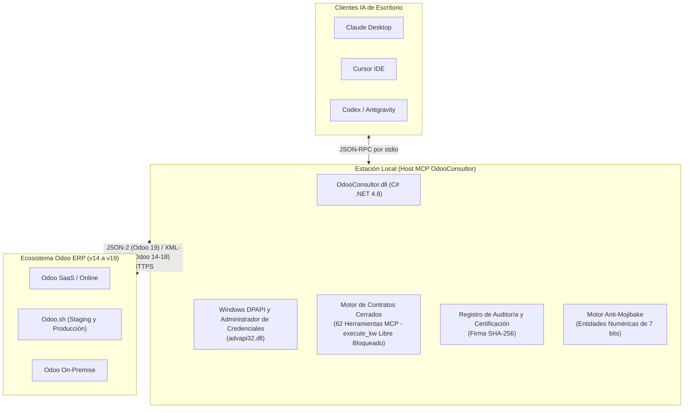
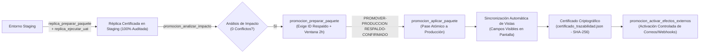
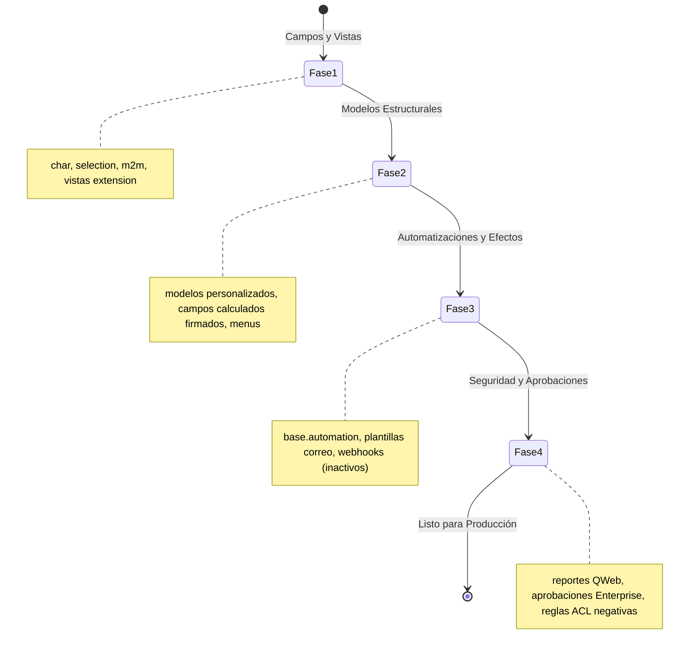

# Odoo Consultor Copilot ⚡

[](LICENSE)
[](https://github.com/jjaraujoa/Odoo-Consultor-Copilot/actions/workflows/ci.yml)
[](https://www.odoo.com)
[-orange.svg)](https://modelcontextprotocol.io)
[](https://dotnet.microsoft.com)

**El Copiloto de Inteligencia Artificial Definitivo para Consultores Técnicos y Funcionales de Odoo.**
Servidor local en C# bajo el estándar Model Context Protocol (MCP) que permite a clientes de IA de escritorio (Claude Desktop, Cursor, Codex, Antigravity) inspeccionar, personalizar, probar, documentar y promover soluciones Odoo ERP de forma segura, sin instalar módulos invasivos en el servidor ni requerir desarrollo de código Python a medida.

---

[🇬🇧 **English Version available here**](README.md)

---

## ¿Por qué Odoo Consultor Copilot?

La consultoría e implantación de Odoo presenta importantes desafíos operativos:
- **Restricciones de Odoo SaaS / Online**: Miles de empresas operan en la nube SaaS de Odoo donde no es posible instalar módulos Python personalizados sin contratar costosos planes de Odoo.sh.
- **Modificaciones Riesgosas en Producción**: Realizar ajustes directos en entornos productivos suele provocar caídas del sistema, rupturas en herencias de vistas o descuadres contables.
- **Cuellos de Botella del Consultor**: Crear campos personalizados, flujos de aprobación, automatizaciones, matrices de GAPs y actas de entrega consume decenas de horas manuales por proyecto.
- **Privacidad y Seguridad Corporativa**: Las empresas no pueden arriesgarse a transmitir credenciales o esquemas de base de datos a través de intermediarios en la nube.

**Odoo Consultor Copilot resuelve este problema de raíz.** Ejecutándose 100% de forma local en la estación de trabajo del consultor, se conecta a Odoo mediante APIs estándar JSON-2 y XML-RPC, protege las credenciales mediante la API DPAPI de Windows, expone **62 herramientas MCP fuertemente tipadas y cerradas**, y proporciona compuertas de seguridad estrictas tanto para Staging como para Producción.

---

## Arquitectura del Sistema



---

## Los 8 Pilares Fundamentales

### 1. Personalizaciones con Studio (Cero Código / Apto para SaaS)
- **Inspección Profunda de Esquemas**: Inspecciona modelos de base de datos (`ir.model`, `ir.model.fields`, `ir.ui.view`) mediante contratos cerrados sin extraer registros de negocio confidenciales.
- **Ingeniería Aditiva**: Construye campos personalizados (`x_`), selecciones dinámicas, enlaces relacionales (`many2one`, `many2many`) y vistas heredadas tipo extensión respetando el árbol XPath nativo.
- **Actualizaciones Estándar Garantizadas**: Las personalizaciones construidas bajo la filosofía Studio sobreviven limpiamente a futuras migraciones de versión mayor de Odoo.

### 2. Flujos Nativos y Buenas Prácticas (Nivel Senior)
- **Filosofía Estándar Primero**: Aprovecha los flujos nativos de Odoo antes de sugerir desarrollos a medida, preservando la coherencia del ERP.
- **Clasificación por Estabilidad**: Evalúa si un requerimiento debe resolverse mediante parametrización nativa, acciones automatizadas, Studio o desarrollo Python.

### 3. Matriz de GAPs y Diagnóstico en Minutos
- **Identificación Automática de Brechas**: Compara requerimientos funcionales contra las capacidades estándar de Odoo en todas sus aplicaciones oficiales.
- **Clasificación Estandarizada**: Clasifica cada brecha en *Estándar (Configuración)*, *Studio (Aditivo)*, *Módulo a Medida (Python)* o *Fuera de Alcance*.
- **Consolidado Dinámico**: Genera matrices estructuradas listas para aprobación del cliente.

### 4. Carga Masiva y Limpieza de Datos Maestros
- **Motor de Validación**: Valida catálogos maestros (contactos, productos, plan contable, listas de precios, ubicaciones) contra restricciones técnicas y claves foráneas antes de importar.
- **Higiene de Datos**: Detecta duplicados, identificadores fiscales mal formados e inconsistencias relacionales antes de comprometer la base de datos.

### 5. Diagnóstico de BD y Corrección de Errores
- **Descubrimiento Autónomo de BD**: Detecta automáticamente el nombre técnico de la base de datos, tipo de alojamiento (SaaS, Odoo.sh, On-Premise) y versión del servidor únicamente a partir de la URL, sin requerir credenciales previas.
- **Inspección de Vistas y Modelos**: Diagnostica referencias XPath rotas en vistas heredadas, dependencias faltantes y registros huérfanos que provocan errores en el cliente web.

### 6. Escenarios de Prueba para Consultoría y Ventas
- **Flujos Continuos Transversales**: Genera y ejecuta ciclos operativos completos entre múltiples aplicaciones:
  $$\text{Iniciativa CRM} \longrightarrow \text{Presupuesto / Pedido} \longrightarrow \text{Albarán de Entrega} \longrightarrow \text{Factura de Cliente} \longrightarrow \text{Conciliación de Pago}$$
- **Registros Sintéticos Trazables**: Emplea prefijos identificadores específicos (`odoo_ai_demo`) para distinguir datos de prueba de datos reales.

### 7. Tableros y Hojas de Cálculo Interactivas (Odoo 18 y 19)
- **Cumplimiento de las 5 Reglas Arquitectónicas**: Aplica validación estricta para modelos `spreadsheet.dashboard` y `documents.document`.
- **Dominios AST 2D y Envoltura de Acciones**: Construye enlaces `odoo://view` con objetos anidados `action` y valida dominios bidimensionales (`[["campo", "=", valor]]`).
- **Seguridad Unicode**: Codifica caracteres no ASCII como secuencias de escape Unicode nativas (`\u00f3`, `\u00e1`), eliminando errores de fórmulas y etiquetas rotas.

### 8. Seguridad Empresarial y Cero Módulos Invasivos (MIT)
- **Sin Módulos Externos**: Se comunica exclusivamente mediante APIs estándar por HTTPS; no instala módulos de terceros en el servidor del cliente.
- **Protección Local por DPAPI**: Las credenciales se cifran en el Administrador de Credenciales de Windows bajo el perfil del usuario actual. Ninguna API key se guarda en texto plano ni entra al contexto de la IA.

---

## Capacidades Avanzadas (Más Allá de lo Convencional)



### 1. Pipeline Seguro de Promoción a Producción
Llevar personalizaciones de Staging a Producción suele ser crítico. Odoo Consultor Copilot implementa un pipeline formal y determinista:
- **Certificación Previa Obligatoria en Staging**: Todo cambio debe estar 100% verificado y probado en Staging antes de poder compilar un paquete de promoción.
- **Análisis de Colisiones e Impacto**: Inspecciona Producción en solo lectura (`promocion_analizar_impacto`) verificando que no existan campos duplicados ni colisiones de vistas (`conflicts == 0`).
- **Referencia de Respaldo Obligatoria**: Exige ingresar el ID o referencia del snapshot/respaldo previo realizado en producción (mínimo 5 caracteres).
- **Ventana Temporal de 2 Horas**: Los paquetes de promoción en producción expiran a las 2 horas (frente a 12 horas en Staging).
- **Token de Confirmación Reforzado**: Requiere la confirmación explícita: `PROMOVER-PRODUCCION <id> RESPALDO-CONFIRMADO`.
- **Sincronización Automática de Vistas**: Inspecciona las vistas heredadas de Staging y las proyecta en Producción aplicando entidades de 7 bits, asegurando que los campos promovidos sean inmediatamente visibles en pantalla.
- **Certificado de Trazabilidad Criptográfico**: Emite `certificado_trazabilidad.json` firmado con SHA-256 y registra la operación inmutable en `auditoria.jsonl`.

### 2. Ciclo de Vida de Réplicas Studio en 4 Fases



- **Fase 1**: Campos base (`char`, `binary`, `selection`, `many2many`), selecciones técnicas y vistas heredadas.
- **Fase 2**: Modelos estructurales personalizados (`x_`), acciones de ventana, menús y campos calculados con firma.
- **Fase 3**: Acciones automatizadas (`base.automation`), plantillas de correo, actividades automáticas y webhooks con compuertas estrictas (`PROBAR-EFECTO` y `ACTIVAR-EFECTOS`).
- **Fase 4**: Reportes QWeb, reglas de aprobación multi-nivel Enterprise, reglas de registro (record rules) y listas de control de acceso (ACLs) evaluadas con usuarios no administradores.

### 3. Compensación Segura sin Eliminación Permanente (Cero Unlink)
Al ejecutar escenarios de demostración o pruebas de integración, el copiloto protege la base de datos:
- La limpieza (`LIMPIAR-DEMO`) archiva o desactiva registros (`active=False`).
- **El método `unlink` está bloqueado por arquitectura**, evitando rotura de secuencias contables, eliminaciones en cascada y registros huérfanos.

### 4. Motor Anti-Mojibake de 7 Bits
El cliente web de Odoo puede corromper caracteres acentuados en vistas XML heredadas según la configuración regional del servidor. El copiloto traduce automáticamente caracteres especiales a entidades numéricas XML estándar de 7 bits (`&#225;` para á, `&#233;` for é, `&#241;` para ñ), garantizando una visualización impecable.

### 5. Generación Automática de Actas de Entrega (.docx y Markdown)
Al certificar o promover una personalización, el copiloto compila de forma automática actas formales de entrega en Microsoft Word (`.docx`) y Markdown estructurado, incluyendo alcance, catálogo de campos, firmas y resumen ejecutivo.

---

## Catálogo de 62 Herramientas MCP Cerradas

Todas las herramientas operan bajo contratos cerrados y fuertemente tipados. El modelo no ejecuta llamadas arbitrarias.

| Categoría | Herramientas | Descripción |
| :--- | :--- | :--- |
| **Conexión y Descubrimiento** | `conexion_estado`<br>`conexion_probar`<br>`odoo_descubrir_capacidades`<br>`odoo_descubrir_base_datos` | Prueba credenciales, mide latencia en vivo, descubre versión/serie (14 a 19), verifica permisos de administrador e infiere el nombre técnico de la base de datos sin credenciales previas. |
| **Inspección y Comparación** | `odoo_inspeccionar_modelo`<br>`studio_inventariar`<br>`odoo_consultar_registros`<br>`odoo_comparar_configuracion` | Inspección de solo lectura de campos, vistas heredadas y metadatos Studio; compara modelos entre Staging y Producción usando hashes. |
| **Cambios Declarativos** | `cambio_validar_contrato`<br>`cambio_preparar_paquete`<br>`studio_preparar_cambio` | Valida modificaciones aditivas contra políticas de seguridad y las compila en paquetes ejecutables con ventana de caducidad. |
| **Réplicas Studio (Fases 1-4)** | `replica_analizar_destino`<br>`replica_preparar_paquete`<br>`replica_ejecutar_uat`<br>`replica_probar_efecto_externo`<br>`replica_activar_efectos_externos`<br>`replica_verificar_acceso_negativo` | Gestión integral de réplicas Studio en modelos, vistas, automatizaciones, reportes QWeb, aprobaciones y pruebas negativas de permisos. |
| **Promoción Segura a Producción** | `promocion_analizar_impacto`<br>`promocion_preparar_runbook`<br>`promocion_verificar_produccion`<br>`promocion_preparar_paquete`<br>`promocion_aplicar_paquete`<br>`promocion_activar_efectos_externos` | Runbooks duales, análisis de colisiones, compuerta de respaldo obligatorio, aplicación atómica, sincronización visual de vistas y certificación SHA-256. |
| **Escenarios Operativos** | `demo_preparar_flujo`<br>`demo_crear_paquete`<br>`demo_aplicar_paquete`<br>`demo_ejecutar_flujo`<br>`demo_compensar_paquete` | Flujos continuos entre aplicaciones (CRM a Pago), generación de datos sintéticos, transiciones de estado y compensación segura por archivo. |
| **Tableros y Hojas de Cálculo** | `tablero_validar_compatibilidad`<br>`tablero_auto_reparar`<br>`tablero_inspeccionar_formulas`<br>`tablero_compilar_enlaces` | Audita las 5 reglas de compatibilidad, repara dominios AST 2D, compila enlaces `odoo://view` con objetos de acción y escapa fórmulas Unicode. |
| **Datos Maestros e Incorporación** | `datos_validar_plantilla`<br>`datos_analizar_inconsistencias`<br>`datos_preparar_importacion`<br>`datos_ejecutar_carga` | Verificación estructural de catálogos de contactos/productos, detección de duplicados e importaciones masivas por lotes. |
| **Matriz de GAPs y Gobernanza** | `gaps_clasificar_requerimiento`<br>`gaps_construir_matriz`<br>`gaps_generar_consolidado`<br>`documentacion_generar_acta` | Clasificación de requerimientos, compilación de matrices de brechas y generación automática de actas de entrega en Word (`.docx`). |

---

## Guía de Inicio Rápido (Consola)

### Vía Rápida para Consultores (Binario Precompilado)

No requiere instalar SDKs ni herramientas de compilación.

#### 1. Descargar la Versión
Descarga los archivos `OdooConsultor.dll` y `OdooConsultor.ps1` desde el último [Release en GitHub](https://github.com/jjaraujoa/Odoo-Consultor-Copilot/releases).

#### 2. Crear un Proyecto de Cliente Local
Abre Windows PowerShell y ejecuta:
```powershell
powershell -ExecutionPolicy RemoteSigned -File .\consultant-host\OdooConsultor.ps1 proyecto crear `
    --ruta "C:\OdooAI\Clientes\mi-cliente" `
    --slug "mi-cliente" `
    --nombre "Mi Cliente S.A."
```

#### 3. Registrar Conexiones de Forma Segura
Registra las credenciales de Staging y Producción. Una ventana nativa de Windows solicitará la API key de forma protegida:
```powershell
# Registrar entorno Staging (lectura y paquetes de escritura)
powershell -ExecutionPolicy RemoteSigned -File .\consultant-host\OdooConsultor.ps1 conexion agregar `
    --proyecto "C:\OdooAI\Clientes\mi-cliente" `
    --entorno staging `
    --url "https://mi-cliente-staging.odoo.com" `
    --login "consultor@empresa.com"

# Registrar entorno Producción (solo lectura por defecto)
powershell -ExecutionPolicy RemoteSigned -File .\consultant-host\OdooConsultor.ps1 conexion agregar `
    --proyecto "C:\OdooAI\Clientes\mi-cliente" `
    --entorno production `
    --url "https://mi-cliente.odoo.com" `
    --login "consultor@empresa.com"
```
*(Para instancias de Odoo 14 a 18, incluye también el parámetro `--base <nombre_tecnico_bd>`)*.

#### 4. Configurar tu Cliente de IA de Escritorio

##### Claude Desktop (`%APPDATA%\Claude\claude_desktop_config.json`)
```json
{
  "mcpServers": {
    "odoo-consultor": {
      "command": "powershell.exe",
      "args": [
        "-NoLogo",
        "-NoProfile",
        "-ExecutionPolicy",
        "RemoteSigned",
        "-File",
        "C:\\OdooAI\\Odoo-Consultor-Copilot\\consultant-host\\OdooConsultor.ps1",
        "mcp",
        "--proyecto",
        "C:\\OdooAI\\Clientes\\mi-cliente"
      ]
    }
  }
}
```

##### Cursor IDE (`.cursor/mcp.json`)
```json
{
  "mcpServers": {
    "odoo-consultor": {
      "command": "powershell.exe",
      "args": [
        "-NoLogo",
        "-NoProfile",
        "-ExecutionPolicy",
        "RemoteSigned",
        "-File",
        "C:\\OdooAI\\Odoo-Consultor-Copilot\\consultant-host\\OdooConsultor.ps1",
        "mcp",
        "--proyecto",
        "C:\\OdooAI\\Clientes\\mi-cliente"
      ]
    }
  }
}
```

---

### Vía de Desarrollador (Compilación desde Fuentes)

Para desarrolladores que deseen auditar el código fuente, contribuir o extender funcionalidades:

```powershell
# 1. Clonar el repositorio
git clone https://github.com/jjaraujoa/Odoo-Consultor-Copilot.git
cd Odoo-Consultor-Copilot

# 2. Compilar la solución usando el proyecto SDK moderno
dotnet build consultant-host/OdooConsultor.csproj -c Release

# O compilar mediante el script de PowerShell:
powershell -ExecutionPolicy RemoteSigned -File .\scripts\Build-OdooConsultor.ps1 -OutputName OdooConsultor.dll

# 3. Ejecutar la suite completa de pruebas de regresión (199 comprobaciones)
powershell -ExecutionPolicy RemoteSigned -File .\scripts\Test-OdooConsultor.ps1 -ExecutablePath .\consultant-host\bin\OdooConsultor.dll
```

---

## Hoja de Ruta (Roadmap)

- [x] **v1.0.0**: 62 herramientas MCP, diagnóstico de conexión en vivo, descubrimiento autónomo de BD, réplicas Studio en 4 fases, promoción segura con auto-sincronización visual de vistas, suite de 199 pruebas y CI/CD en Windows.
- [ ] **v1.1.0**: Detección estática de referencias huérfanas en vistas QWeb anidadas.
- [ ] **v1.2.0**: Simulador de permisos ACL offline para evaluar grupos de seguridad antes de su despliegue en servidor.
- [ ] **v2.0.0**: Motor multiplataforma en .NET 8 / .NET 9 (desacoplando Windows DPAPI mediante almacén seguro multiplataforma).

---

## Contribuciones y Seguridad

- **Contribuciones**: Consulta [CONTRIBUTING.md](CONTRIBUTING.md) para estándares de código, pruebas obligatorias y directrices de pull requests.
- **Seguridad**: Consulta [SECURITY.md](SECURITY.md) para reporte de vulnerabilidades y detalles de la arquitectura de protección.
- **Historial de Cambios**: Revisa [CHANGELOG.md](CHANGELOG.md) para consultar las notas históricas de cada versión.

---

## Autor y Licencia

Desarrollado por **Jorge Araujo** (`jjaraujoa@eafit.edu.com`).
Distribuido bajo la licencia de código abierto **[MIT](LICENSE)**.
