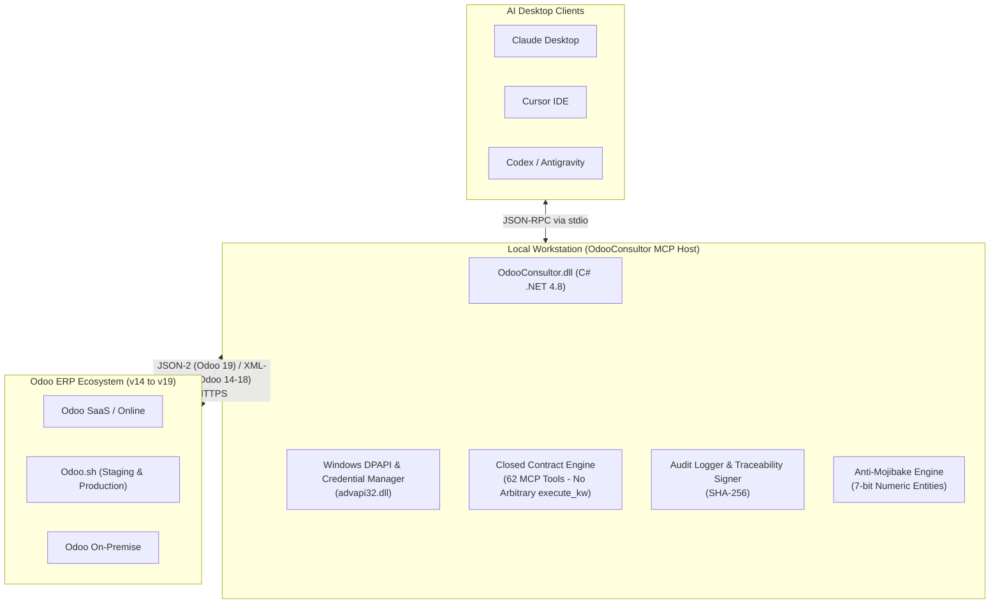
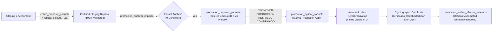
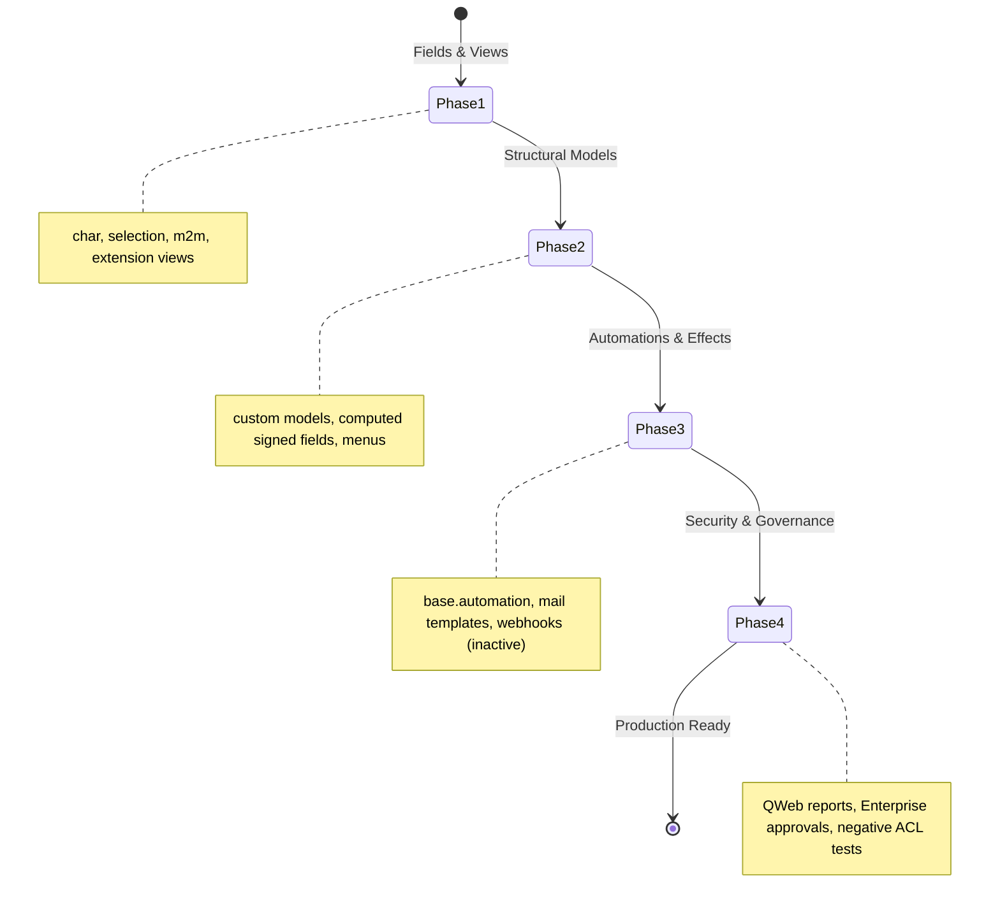

# Odoo Consultor Copilot ⚡

[](LICENSE)
[](https://github.com/jjaraujoa/Odoo-Consultor-Copilot/actions/workflows/ci.yml)
[](https://www.odoo.com)
[-orange.svg)](https://modelcontextprotocol.io)
[](https://dotnet.microsoft.com)

**The Ultimate AI Copilot for Technical and Functional Odoo Consultants.**
A local, production-grade Model Context Protocol (MCP) server written in C# that empowers AI desktop clients (Claude Desktop, Cursor, Codex, Antigravity) to inspect, customize, test, document, and safely promote Odoo ERP implementations without installing invasive server-side modules or writing custom Python code.

---

[🇪🇸 **Versión en Español disponible aquí**](README.es.md)

---

## Why Odoo Consultor Copilot?

ERP consulting for Odoo presents several persistent operational challenges:
- **SaaS / Online Limitations**: Thousands of companies run on Odoo SaaS/Online where custom Python modules cannot be installed without paying for costly Odoo.sh hosting tiers.
- **Risky Production Modifications**: Direct adjustments in production environments often trigger downtime, broken view inheritances, or accounting imbalances.
- **Consultant Bottlenecks**: Creating custom fields, multi-level approval workflows, automated actions, GAP matrices, and delivery documentation consumes dozens of manual hours per project.
- **Vendor Lock-In & Cloud Privacy**: Many enterprise customers prohibit transmitting internal database credentials or schemas through third-party cloud brokers.

**Odoo Consultor Copilot solves this at the root.** Running 100% locally on the consultant's machine, it connects to Odoo via native JSON-2 / XML-RPC APIs, protects secrets in Windows DPAPI, exposes **62 strongly-typed, closed MCP tools**, and provides a battle-tested safety harness for Staging and Production environments.

---

## System Architecture



---

## The 8 Core Pillars

### 1. Studio Customizations (Zero-Code / SaaS-Friendly)
- **Deep Schema Inspection**: Automatically inspects underlying database models (`ir.model`, `ir.model.fields`, `ir.ui.view`) using closed contracts without pulling full business datasets.
- **Additive Engineering**: Constructs additive custom fields (`x_`), dynamic selections, relational links (`many2one`, `many2many`), and inherited views respecting native XPath extension trees.
- **100% Standard Upgrade Path**: Customizations built via Studio principles persist cleanly across future Odoo major version upgrades.

### 2. Senior-Level Native Architecture & Best Practices
- **Standard-First Philosophy**: Leverages native Odoo functional flows before recommending bespoke alterations, preserving ERP standard behavior.
- **Lifecycle Classification**: Evaluates business requirements to determine whether they belong in basic settings, automated actions, Studio, or custom development.

### 3. GAP Matrix & Rapid Functional Diagnostics
- **Automated Gap Identification**: Compares client functional specifications against standard out-of-the-box Odoo capabilities across all official applications.
- **Standardized Classification**: Categorizes each gap into *Standard (Settings)*, *Studio (No-Code)*, *Custom Module (Python)*, or *Out of Scope*.
- **Dynamic Consolidation**: Compiles structured matrices ready for stakeholder sign-off.

### 4. Master Data Onboarding & Mass Processing
- **Validation Engine**: Verifies master data catalogs (partners, products, chart of accounts, price lists, stock locations) against technical constraints and foreign keys before ingestion.
- **Data Hygiene**: Detects duplicates, unformatted fiscal IDs, and relational mismatches prior to database commits.

### 5. Database Diagnostics & Root Cause Analysis
- **Autonomous DB Discovery**: Automatically detects the technical database name, hosting tier (SaaS, Odoo.sh, On-Premise), and server version from URL alone without prior authentication.
- **View & Model Inspection**: Diagnoses broken XPath inheritance references, missing module dependencies, and orphan records causing web client crashes.

### 6. End-to-End Operational & Sales Scenarios
- **Continuous Lifecycle Testing**: Generates and executes full cross-application business cycles:
  $$\text{CRM Lead} \longrightarrow \text{Sales Order} \longrightarrow \text{Delivery (Picking)} \longrightarrow \text{Customer Invoice} \longrightarrow \text{Bank Payment}$$
- **Traceable Synthetic Records**: Employs unique synthetic prefixes (`odoo_ai_demo`) to easily distinguish demonstration data from genuine records.

### 7. Interactive Dashboards & Spreadsheets (Odoo 18 & 19)
- **Compliance with 5 Architectural Rules**: Enforces strict compatibility for `spreadsheet.dashboard` and `documents.document` models.
- **2D AST Domains & Action Envelopes**: Auto-formats `odoo://view` links with nested `action` objects and validates bidimensional domain tuples (`[["field", "=", value]]`).
- **Unicode Safety**: Encodes non-ASCII characters as native Unicode escape sequences (`\u00f3`, `\u00e1`) to eliminate formula and label corruption.

### 8. Enterprise Security & Local Privacy (MIT)
- **Zero Invasive Modules**: Connects exclusively via standard HTTPS APIs; does not install third-party Python modules on your client's servers.
- **Local DPAPI Protection**: Credentials remain strictly encrypted in Windows Credential Manager under the current user's profile. No API keys ever touch configuration files or chat context.

---

## Advanced Capabilities (Beyond the Basics)



### 1. Safe Production Promotion Pipeline
Moving customizations from Staging to Production is typically high-risk. Odoo Consultor Copilot introduces a formal, deterministic promotion pipeline:
- **Mandatory Staging Certification**: A customization must be 100% verified and tested in Staging before a promotion package can even be compiled.
- **Collision & Impact Analysis**: Pre-promotion inspection (`promocion_analizar_impacto`) checks for duplicate fields, view ID collisions, and schema mismatches in read-only mode (`conflicts == 0` gate).
- **Mandatory Backup Reference**: Compiling a package requires registering the client's backup snapshot reference (minimum 5 characters).
- **Strict 2-Hour Time Window**: Production promotion packages expire automatically after 2 hours (compared to 12 hours in Staging).
- **Reinforced Confirmation Token**: Execution requires the explicit token: `PROMOVER-PRODUCCION <id> RESPALDO-CONFIRMADO`.
- **Automatic Visual View Synchronization**: Inspects Staging inherited views and automatically mirrors them into Production parent views using 7-bit entities, ensuring promoted fields are immediately visible on screen.
- **Cryptographic Traceability Certificate**: Issues `certificado_trazabilidad.json` signed with SHA-256 and appends an immutable record to `auditoria.jsonl`.

### 2. Studio 4-Phase Replication Lifecycle



- **Phase 1**: Base fields (`char`, `binary`, `selection`, `many2many`), technical selection options, and inherited extension views.
- **Phase 2**: Custom structural models (`x_`), window actions, menu hierarchies, and computed fields with signature tracking.
- **Phase 3**: Automated actions (`base.automation`), email templates, scheduled activities, and webhooks with strict trial gates (`PROBAR-EFECTO` and `ACTIVAR-EFECTOS`).
- **Phase 4**: QWeb reports, Enterprise multi-level approval rules, record rules, and ACLs tested through separate non-privileged personas.

### 3. Non-Destructive Compensation (No-Unlink Guarantee)
When executing demo scenarios or integration tests, the copilot guarantees database safety:
- Cleaning up demo data (`LIMPIAR-DEMO`) archives or deactivates records (`active=False`).
- **`unlink` is architecturally prohibited** in compensation routines, preventing foreign key cascades, orphan accounting entries, and inventory breaks.

### 4. 7-Bit Anti-Mojibake Engine
Odoo web client can corrupt non-ASCII characters in inherited XML views depending on server locale settings. The copilot automatically translates non-ASCII characters to standard 7-bit numeric XML entities (`&#225;` for á, `&#233;` for é, `&#241;` for ñ), guaranteeing clean visual rendering across any language.

### 5. Automated Delivery Minutes (.docx & Markdown)
Upon completing a deployment or certification, the copilot automatically generates formal executive delivery minutes (Actas de Entrega) in Microsoft Word (`.docx`) and structured Markdown, including change logs, model definitions, audit hashes, and signature blocks.

---

## Catalog of 62 Strongly-Typed MCP Tools

All tools are closed, deterministic, and strictly validated. The LLM cannot execute arbitrary Python methods.

| Category | Tools | Description |
| :--- | :--- | :--- |
| **Connection & Discovery** | `conexion_estado`<br>`conexion_probar`<br>`odoo_descubrir_capacidades`<br>`odoo_descubrir_base_datos` | Tests credentials, measures latency, discovers server series (14-19), checks admin rights, and infers technical database name without prior credentials. |
| **Inspection & Comparison** | `odoo_inspeccionar_modelo`<br>`studio_inventariar`<br>`odoo_consultar_registros`<br>`odoo_comparar_configuracion` | Read-only inspection of fields, inherited views, and Studio metadata; compares models between Staging and Production using hashes. |
| **Declarative Changes** | `cambio_validar_contrato`<br>`cambio_preparar_paquete`<br>`studio_preparar_cambio` | Validates additive modifications against security policy and compiles them into signed, time-limited execution packages. |
| **Studio Replication (Phases 1-4)** | `replica_analizar_destino`<br>`replica_preparar_paquete`<br>`replica_ejecutar_uat`<br>`replica_probar_efecto_externo`<br>`replica_activar_efectos_externos`<br>`replica_verificar_acceso_negativo` | End-to-end management of Studio replicas across models, views, automations, QWeb reports, approvals, and negative ACL tests. |
| **Safe Production Promotion** | `promocion_analizar_impacto`<br>`promocion_preparar_runbook`<br>`promocion_verificar_produccion`<br>`promocion_preparar_paquete`<br>`promocion_aplicar_paquete`<br>`promocion_activar_efectos_externos` | Dual runbooks, collision analysis, verified backup gate, atomic application, view auto-synchronization, and cryptographic certification. |
| **Operational Scenarios** | `demo_preparar_flujo`<br>`demo_crear_paquete`<br>`demo_aplicar_paquete`<br>`demo_ejecutar_flujo`<br>`demo_compensar_paquete` | Cross-app business flows (CRM to Payment), synthetic record generation, state transitions, and safe archiving cleanup. |
| **Spreadsheets & Dashboards** | `tablero_validar_compatibilidad`<br>`tablero_auto_reparar`<br>`tablero_inspeccionar_formulas`<br>`tablero_compilar_enlaces` | Audits 5 compatibility rules, fixes AST domains, builds `odoo://view` action links, and escapes Unicode formulas. |
| **Master Data & Onboarding** | `datos_validar_plantilla`<br>`datos_analizar_inconsistencias`<br>`datos_preparar_importacion`<br>`datos_ejecutar_carga` | Structural verification of partner/product catalogs, duplicate detection, and staged batch imports. |
| **GAP Analysis & Governance** | `gaps_clasificar_requerimiento`<br>`gaps_construir_matriz`<br>`gaps_generar_consolidado`<br>`documentacion_generar_acta` | Requirement classification, gap matrix generation, and automated Word (`.docx`) delivery minutes compilation. |

---

## Console Quick Start

### Fast-Track for Consultants (Pre-compiled Binary)

No development tools or .NET SDKs required.

#### 1. Download the Release
Download `OdooConsultor.dll` and `OdooConsultor.ps1` from the latest [GitHub Release](https://github.com/jjaraujoa/Odoo-Consultor-Copilot/releases).

#### 2. Create a Local Client Project
Open Windows PowerShell and run:
```powershell
powershell -ExecutionPolicy RemoteSigned -File .\consultant-host\OdooConsultor.ps1 proyecto crear `
    --ruta "C:\OdooAI\Clientes\mi-cliente" `
    --slug "mi-cliente" `
    --nombre "Mi Cliente S.A."
```

#### 3. Securely Register Odoo Connections
Add your Staging and Production credentials. A native Windows dialog prompts for the API key, storing it safely in Windows DPAPI:
```powershell
# Register Staging (read/write packages)
powershell -ExecutionPolicy RemoteSigned -File .\consultant-host\OdooConsultor.ps1 conexion agregar `
    --proyecto "C:\OdooAI\Clientes\mi-cliente" `
    --entorno staging `
    --url "https://mi-cliente-staging.odoo.com" `
    --login "consultor@empresa.com"

# Register Production (read-only by default)
powershell -ExecutionPolicy RemoteSigned -File .\consultant-host\OdooConsultor.ps1 conexion agregar `
    --proyecto "C:\OdooAI\Clientes\mi-cliente" `
    --entorno production `
    --url "https://mi-cliente.odoo.com" `
    --login "consultor@empresa.com"
```
*(For Odoo 14 to 18 instances, also include `--base <technical_db_name>`)*.

#### 4. Configure Your AI Desktop Client

##### Claude Desktop (`%APPDATA%\Claude\claude_desktop_config.json`)
```json
{
  "mcpServers": {
    "odoo-consultor": {
      "command": "powershell.exe",
      "args": [
        "-NoLogo",
        "-NoProfile",
        "-ExecutionPolicy",
        "RemoteSigned",
        "-File",
        "C:\\OdooAI\\Odoo-Consultor-Copilot\\consultant-host\\OdooConsultor.ps1",
        "mcp",
        "--proyecto",
        "C:\\OdooAI\\Clientes\\mi-cliente"
      ]
    }
  }
}
```

##### Cursor IDE (`.cursor/mcp.json`)
```json
{
  "mcpServers": {
    "odoo-consultor": {
      "command": "powershell.exe",
      "args": [
        "-NoLogo",
        "-NoProfile",
        "-ExecutionPolicy",
        "RemoteSigned",
        "-File",
        "C:\\OdooAI\\Odoo-Consultor-Copilot\\consultant-host\\OdooConsultor.ps1",
        "mcp",
        "--proyecto",
        "C:\\OdooAI\\Clientes\\mi-cliente"
      ]
    }
  }
}
```

---

### Developer Track (Build from Source)

For developers wishing to inspect the source code, contribute, or extend functionality:

```powershell
# 1. Clone the repository
git clone https://github.com/jjaraujoa/Odoo-Consultor-Copilot.git
cd Odoo-Consultor-Copilot

# 2. Build the solution using modern SDK-style project
dotnet build consultant-host/OdooConsultor.csproj -c Release

# Or compile using the PowerShell build script:
powershell -ExecutionPolicy RemoteSigned -File .\scripts\Build-OdooConsultor.ps1 -OutputName OdooConsultor.dll

# 3. Run the full regression test suite (199 automated self-tests)
powershell -ExecutionPolicy RemoteSigned -File .\scripts\Test-OdooConsultor.ps1 -ExecutablePath .\consultant-host\bin\OdooConsultor.dll
```

---

## Roadmap

- [x] **v1.0.0**: 62 MCP Tools, live connection diagnostics, autonomous DB discovery, Studio 4-phase replication, safe production promotion with view auto-sync, 199 self-tests, and Windows CI/CD.
- [ ] **v1.1.0**: Automated static orphan-reference detection for deeply nested QWeb views.
- [ ] **v1.2.0**: Offline ACL permission simulator to evaluate security groups before server deployment.
- [ ] **v2.0.0**: Multiplatform .NET 8 / .NET 9 engine (decoupling Windows DPAPI via cross-platform secure store).

---

## Contributing & Security

- **Contributing**: Please review [CONTRIBUTING.md](CONTRIBUTING.md) for code standards, testing policies, and pull request guidelines.
- **Security**: Please review [SECURITY.md](SECURITY.md) for vulnerability reporting and architecture details.
- **Changelog**: See [CHANGELOG.md](CHANGELOG.md) for historical release notes.

---

## Author & License

Developed with passion by **Jorge Araujo** (`jjaraujoa@eafit.edu.com`).
Licensed under the open source **[MIT License](LICENSE)**.
