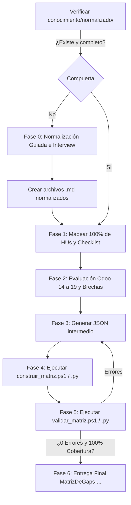

# Skill: Matriz de GAPs de Odoo (`odoo-matriz-gaps`)

Esta skill estandariza el levantamiento, análisis, evaluación, compilación y aseguramiento de calidad del entregable oficial **Matriz de GAPs** en proyectos de consultoría e implementación de Odoo (versiones 14 a 19, Enterprise y Community), utilizando la plantilla estándar **MAT-GAP-001**.

---

## 1. Regla de Oro: Compuerta Estricta de Normalización Previa (Gatekeeper)

> [!CAUTION]
> **PROHIBIDO CONSTRUIR LA MATRIZ SOBRE INFORMACIÓN CRUDA O NO NORMALIZADA**
> La Matriz de GAPs **NUNCA** se genera directamente desde checklists en Excel sin procesar, transcripciones desordenadas de reuniones, notas sueltas ni correos electrónicos.

### Validación Obligatoria de Entrada
Antes de formular cualquier fila de la matriz, el agente **DEBE** verificar si en el proyecto existen los archivos Markdown normalizados en:
- `conocimiento/normalizado/modulos/` (procesos operativos por módulo y checklist normalizado con códigos `MOD-001`).
- `conocimiento/normalizado/reportes/` (fichas de informes requeridos con códigos `REP-MOD-001`).
- `conocimiento/normalizado/historias-usuario/` (historias de usuario por área: `crm.md`, `ventas.md`, `inventario.md`, `contabilidad.md`, `compras.md`, etc., con códigos `HU-MOD-001`).

### Si el conocimiento NO está normalizado (Activación de Fase 0)
Si dichos archivos no existen, están incompletos o presentan ambigüedades:
1. **Detener la formulación de la matriz.**
2. Notificar al consultor que se iniciará la **Fase 0: Normalización Guiada**.
3. Revisar el material fuente (Checklist de levantamiento, notas o transcripciones).
4. Realizar preguntas puntuales y claras al consultor sobre temas oscuros, vacíos o flujos ambiguos.
5. Redactar los archivos estructurados `.md` de procesos, reportes e historias de usuario con la taxonomía oficial:
   - Metadatos YAML (tipo, módulo, clasificación de fuente, historias, atención especial).
   - Códigos trazables `HU-<MOD>-001`, `MOD-001`, `REP-<MOD>-001`.
   - Criterios de aceptación y resultado esperado.
   - Marcas visuales de atención especial (`negrita`, resaltado, etc.).
6. Solo tras validar y persistir los archivos normalizados, proceder a la Matriz de GAPs.

---

## 2. Estructura del Libro Excel y Plantilla Embebida

> [!IMPORTANT]
> **PLANTILLA BASE EMBEBIDA Y FIJA (CERO ADJUNTOS MANUALES)**
> La plantilla estándar de consultoría (`FormatoMatrizDeGaps-Estandar-V1.xlsx`) reside de forma fija y permanente en la carpeta `assets/` de esta skill.
> - El consultor **NUNCA** debe adjuntar la plantilla de Excel en el chat ni buscarla en descargas.
> - El agente **NUNCA** debe solicitar una plantilla externa al usuario.
> - Los compiladores (`scripts/construir_matriz.ps1` y `scripts/construir_matriz.py`) toman automáticamente este archivo embebido por defecto para clonarlo y producir el entregable final en la carpeta del cliente (`outputs/`).
> Esto blinda la homogeneidad de entrega e imposibilita que se utilicen versiones adulteradas, obsoletas o con fórmulas rotas.

El libro Excel generado contiene:
- **Hojas Funcionales Estándar**:
  1. `Contabilidad`
  2. `Inventarios` (o `Inventario`)
  3. `CRM`
  4. `Ventas`
  5. `Compras`
- **Hojas Dinámicas Adicionales**: Si el alcance del proyecto incluye otros módulos (ej. `Fabricación` / MRP, `Proyectos`, `Servicio de Asistencia` / Helpdesk, `Punto de Venta`), el compilador creará automáticamente las hojas correspondientes replicando el encabezado y estructura estándar.
- **Hoja `Consolidado`**: Reúne el 100% de los requerimientos de todas las hojas funcionales en orden secuencial, vinculado estrictamente mediante **fórmulas dinámicas** (`=Hoja!B5`) y casillas nativas vinculadas (`=Hoja!G5`).
- **Encabezado Institucional (Filas 1 a 3)**:
  - Fila 1: Título `"FORMATO MATRIZ DE GAPS"`, Código de formato en columna P (`MAT-GAP-001-...`).
  - Fila 2: Versión en columna P (`V1`, `V2`, etc.).
  - Fila 3: Fecha en columna P (`YYYY-MM-DD`).

---

## 3. Especificación Estricta de Columnas (A a P) y Reglas Lógicas

| Columna | Nombre | Tipo / Formato | Regla Funcional y Validación Obligatoria |
| :--- | :--- | :--- | :--- |
| **A** | **N°** | Entero | Consecutivo numérico en cada hoja funcional (1..N). En el `Consolidado` es un consecutivo global continuo (1..Total). |
| **B** | **Requerimiento** | Texto | Nombre corto, conciso y funcional del requerimiento (ej. *"Facturación electrónica sin OC mediante XML/CUFE"*). |
| **C** | **Compañía** | Texto | Nombre o razón social del cliente (ej. `Pruebas Matriz de GAPs`). |
| **D** | **Fecha de solicitud** | Fecha | Formato `YYYY-MM-DD`. Fecha de formulación o corte del requerimiento. |
| **E** | **Odoo Módulo** | Texto | **Catálogo estricto de Odoo**. Solo apps oficiales (`CRM`, `Ventas`, `Inventario`, `Contabilidad`, `Compras`, etc.) o con subdivisiones/pestañas reales (`CRM / Leads`, `Ventas / Tarifas`, `Inventario / Albaranes`, `Contabilidad / Facturas de cliente`, `CRM / Ventas`). Prohibidos nombres inventados ajenos a Odoo. |
| **F** | **% de ajuste nativo de Odoo** | Porcentaje (`0%`) | Escala estándar: `100%` (1.0), `75%` (0.75), `50%` (0.50), `25%` (0.25), `0%` (0.0). |
| **G** | **Localización Regional** | Casilla interactiva | Marcado si la solución corresponde a módulos de localización o terceros (Nómina electrónica, fiscalidad, etc.). |
| **H** | **Desarrollo** | Casilla interactiva | Marcado si requiere código Python/XML a medida. **Última opción**: solo si Studio, Permisos o Automatizaciones no alcanzan. |
| **I** | **Studio** | Casilla interactiva | Marcado si se resuelve mediante Odoo Studio (campos, vistas, modelos, botones de acción). |
| **J** | **Permisos** | Casilla interactiva | Marcado si se resuelve mediante grupos de seguridad o reglas de registro (`ir.rule`). |
| **K** | **Acción automática o Planificada** | Casilla interactiva | Marcado si se resuelve con automatizaciones estándar (`base.automation` o crons). |
| **L** | **Cómo cumple Odoo el requerimiento** | Texto multilínea | **Estructura obligatoria en 2 párrafos** separados por salto de línea (`\n\n`):<br>1. **Párrafo 1**: Explicación de lo que Odoo cubre nativamente y cómo opera.<br>2. **Párrafo 2** (obligatorio si F < 100%): Inicia expresamente con `NO CUBRE nativamente...` explicando con precisión la brecha funcional (GAP). |
| **M** | **Observaciones** | Texto | - `FUENTE DE NEGOCIO: [IDs...]` **(100% OBLIGATORIO EN TODAS LAS FILAS)** citando las HUs (`HU-CRM-001`), preguntas de checklist (`CRM-002`) o reportes (`REP-CRM-001`).<br>- `OBSERVACIÓN: ...` **(OPCIONAL)**: Solo se coloca si hay una advertencia o comentario funcional relevante. **Prohibido terminantemente colocar "OBSERVACIÓN: Ninguna" o "N/A"**.<br>- **Prohibido incluir enlaces web** (`http/https`) o links a documentación externa de Odoo. |
| **N** | **Requiere Estimación** | `"Si"` / `"No"` | Si **F = 100%** $\rightarrow$ `"No"`.<br>Si **F < 100%** $\rightarrow$ `"Si"`. |
| **O** | **Prioridad** | Desplegable | Valores: `Alta`, `Media`, `Baja`, `No Aplica`.<br>- `Alta`: Obligación fiscal/legal, controles bloqueantes, continuidad operativa o financiera.<br>- `Media`: Eficiencia operativa, trazabilidad, reportes de gestión.<br>- `Baja`: Necesidad secundaria o de baja frecuencia.<br>- `No Aplica`: Cuando F=100% nativo o descartado. |
| **P** | **Observaciones de Desarrollo** | Texto | Diligenciado **obligatoriamente** si la Columna H (`Desarrollo`) está marcada. Debe quedar **vacío (`null`)** si H es `False`. |

---

## 4. Las 4 Reglas Críticas de Calidad y Formato

### Regla 1: Catálogo Estricto de Odoo Módulo (Columna E)
Los valores en Columna E deben corresponder exclusivamente a:
- **Apps oficiales de Odoo**: `CRM`, `Ventas`, `Compras`, `Inventario` (o `Inventarios`), `Contabilidad` (o `Facturación`), `Fabricación` (o `MRP`), `Punto de Venta` (o `PoS`), `Proyectos`, `Servicio de Asistencia` (o `Helpdesk`), `Reparaciones`, `Calidad`, `Mantenimiento`, `Suscripciones`, `Sitio Web`, `Comercio Electrónico`, `Empleados`, `Reclutamiento`, `Gastos`, `Documentos`, `Firma`, `Contactos`, `Tableros`, `Ajustes`, `Studio`, `Localización Regional`.
- **Rutas y submódulos oficiales con barra `/`**:
  - `CRM / Leads`, `CRM / Oportunidades`, `CRM / Equipos de Ventas`
  - `Ventas / Presupuestos`, `Ventas / Pedidos`, `Ventas / Tarifas`, `Ventas / Clientes`
  - `Compras / Solicitudes de Presupuesto`, `Compras / Pedidos de Compra`, `Compras / Proveedores`
  - `Inventario / Operaciones`, `Inventario / Albaranes`, `Inventario / Recepciones`, `Inventario / Ajustes de Inventario`, `Inventario / Rutas`, `Inventario / Productos`
  - `Contabilidad / Facturas de Cliente`, `Contabilidad / Facturas de Proveedor`, `Contabilidad / Asientos Contables`, `Contabilidad / Conciliación Bancaria`, `Contabilidad / Plan de Cuentas`
  - Módulos transversales combinados: `CRM / Ventas`, `Ventas / Inventario`, `Compras / Inventario`, `Ventas / Contabilidad`.
> [!WARNING]
> Prohibido inventar nombres como "Logística de Despachos", "Tesorería Avanzada", "Gestión Comercial Integral", etc.

### Regla 2: Casillas de Verificación Interactivas de Excel 365 (Checks)
- Las columnas G a K **NO** deben mostrar el texto `"VERDADERO"` ni `"FALSO"`.
- Deben conservar el **control nativo de Checkbox interactivo de Microsoft Excel 365** (con recuadro visual de verificación), idéntico al de la plantilla corporativa.
- En las hojas de módulos: casillas interactivas marcables.
- En la hoja `Consolidado`: casillas interactivas vinculadas dinámicamente mediante fórmula (`='Modulo'!Gx`).
- Esto se logra utilizando el compilador nativo con Excel COM (`scripts/construir_matriz.ps1` o `scripts/construir_matriz.py`).

### Regla 3: Cobertura Obligatoria al 100% de Fuentes
- Cada requerimiento levantado en las Historias de Usuario (`HU-...`), en las preguntas del Checklist de Negocio (`...-001`, `MOD-002`) y en las Fichas de Reportes (`REP-...`) **DEBE** estar cubierto en la Matriz de GAPs.
- **Mapeo N a 1 permitido**: Un requerimiento consolidado de la matriz puede cubrir varias preguntas de checklist y varias HUs relacionadas (evitando duplicar requerimientos en Excel).
- **Trazabilidad estricta**: En la celda `FUENTE DE NEGOCIO:` de la Columna M se deben enumerar explícitamente todos los identificadores que dicho requerimiento cubre (ej. `FUENTE DE NEGOCIO: HU-CRM-001, HU-CRM-002, CRM-002, CRM-003, CRM-004`).
- El script de validación (`validar_matriz.ps1` o `validar_matriz.py`) analiza de forma recursiva los archivos `.md` de conocimiento y genera un **error bloqueante** si detecta un solo ID huérfano o sin mapear.

### Regla 4: Formato de Columna M (Observaciones y Fuentes)
- La celda siempre debe contener `FUENTE DE NEGOCIO: [IDs...]`.
- Si NO hay observaciones funcionales particulares, la celda comienza directamente con la fuente de negocio:
  ```text
  FUENTE DE NEGOCIO: HU-VEN-001, VEN-002, VEN-003
  ```
- Si SÍ hay una observación o advertencia para el cliente:
  ```text
  OBSERVACIÓN: Se requiere definir la política de recargo por flete con la gerencia comercial.

  FUENTE DE NEGOCIO: HU-VEN-004, VEN-010
  ```
- Si la HU original tenía marcas de atención especial:
  ```text
  OBSERVACIÓN: ATENCIÓN ESPECIAL DEL CLIENTE — Requiere validación de cupo de crédito bloqueante antes de confirmar pedido.

  FUENTE DE NEGOCIO: HU-VEN-005, VEN-012
  ```
- **Prohibido**: Escribir `OBSERVACIÓN: Ninguna`, `OBSERVACIÓN: N/A`, o colocar enlaces web a URLs de Odoo.

---

## 5. Procedimiento Operativo Paso a Paso



### Paso 1: Mapeo y Consolidación de Fuentes
- Leer recursivamente todos los archivos de `conocimiento/normalizado/`:
  - `historias-usuario/*.md`
  - `modulos/*/*.md`
  - `reportes/*/*.md`
- Extraer todos los identificadores de negocio y agrupar necesidades afines por módulo principal.

### Paso 2: Evaluación Funcional y Redacción de Brechas (GAP)
- Asignar porcentaje en Columna F (`100%`, `75%`, `50%`, `25%`, `0%`).
- Redactar Columna L con la separación en 2 párrafos:
  1. Cobertura nativa en Odoo.
  2. `\n\n` y segundo párrafo: `NO CUBRE nativamente...` con el detalle de la brecha funcional.
- Si F < 100%, seleccionar la alternativa menos invasiva (Studio / Permisos / Automatizaciones antes que Desarrollo). Si se requiere Desarrollo (H), redactar el alcance en Columna P.

### Paso 3: Generación del Archivo JSON Intermedio
El agente genera el archivo estructurado (ej. `outputs/matriz_gaps_input.json`):

```json
{
  "cliente": "Pruebas Matriz de GAPs",
  "fecha": "2026-09-25",
  "version": "1",
  "hojas": {
    "CRM": [
      {
        "requerimiento": "Gestión de iniciativas comerciales y prospección omnicanal",
        "compania": "Pruebas Matriz de GAPs",
        "fecha": "2026-09-25",
        "odoo_modulo": "CRM / Leads",
        "porcentaje_ajuste_nativo": 0.75,
        "localizacion_regional": false,
        "desarrollo": false,
        "studio": true,
        "permisos": false,
        "accion_automatica": false,
        "como_cumple_odoo": "Odoo CRM permite capturar iniciativas comerciales desde correo, formularios web y registro manual con asignación a vendedores.\n\nNO CUBRE nativamente la captura automática desde portales de licitación pública sin integración previa.",
        "observaciones": "FUENTE DE NEGOCIO: HU-CRM-001, CRM-002, CRM-003, CRM-004",
        "requiere_estimacion": "Si",
        "prioridad": "Alta",
        "observaciones_desarrollo": null
      }
    ],
    "Ventas": [ ... ],
    "Inventarios": [ ... ],
    "Contabilidad": [ ... ],
    "Compras": [ ... ]
  }
}
```

### Paso 4: Compilación Técnica con Casillas Nativas de Excel
Ejecutar el compilador oficial. En entornos Windows/PowerShell (Codex Desktop / Antigravity), utilizar:

```powershell
powershell -NoProfile -ExecutionPolicy Bypass -File "skills\odoo-matriz-gaps\scripts\construir_matriz.ps1" `
  -InputJson "outputs\matriz_gaps_input.json" `
  -OutputPath "outputs\FormatoMatrizDeGaps-<Cliente>-<YYYYMMDD>-V1.xlsx"
```

*(O invocar `python scripts/construir_matriz.py outputs/matriz_gaps_input.json`, el cual delega automáticamente en PowerShell COM en sistemas Windows).*

### Paso 5: Auditoría de Calidad y Cobertura 100%
Ejecutar el script validador con la compuerta de verificación de fuentes:

```powershell
powershell -NoProfile -ExecutionPolicy Bypass -File "skills\odoo-matriz-gaps\scripts\validar_matriz.ps1" `
  -ExcelPath "outputs\FormatoMatrizDeGaps-<Cliente>-<YYYYMMDD>-V1.xlsx" `
  -KnowledgeDir "conocimiento\normalizado"
```

El validador inspeccionará:
1. **Catálogo de módulos**: Que la Columna E use exclusivamente módulos y rutas oficiales de Odoo.
2. **Casillas nativas**: Que G a K tengan controles interactivos y que en el Consolidado estén vinculadas por fórmula.
3. **Consistencia lógica**: F = 100% vs F < 100%, Columna N ("Si"/"No") y Columna P con desarrollo.
4. **Redacción de brechas**: Presencia de `NO CUBRE` en Columna L cuando F < 100%.
5. **Formato en M**: Cero URLs externas, `FUENTE DE NEGOCIO:` obligatorio, y sin "OBSERVACIÓN: Ninguna".
6. **Cobertura 100% de fuentes**: Reconciliación de todos los IDs (`HU-...`, `MOD-001`, `REP-...`) contra el conocimiento normalizado.

### Paso 6: Entrega al Consultor
- Presentar el balance ejecutivo:
  - Total de requerimientos evaluados.
  - Porcentaje global de cobertura nativa estándar.
  - Desglose de soluciones (Studio, Localización Regional, Automatizaciones, Desarrollo).
  - Certificación de 100% de fuentes cubiertas (0 requerimientos huérfanos).
- Suministrar la ruta del archivo `.xlsx` listo para su presentación y firma formal con el cliente.
